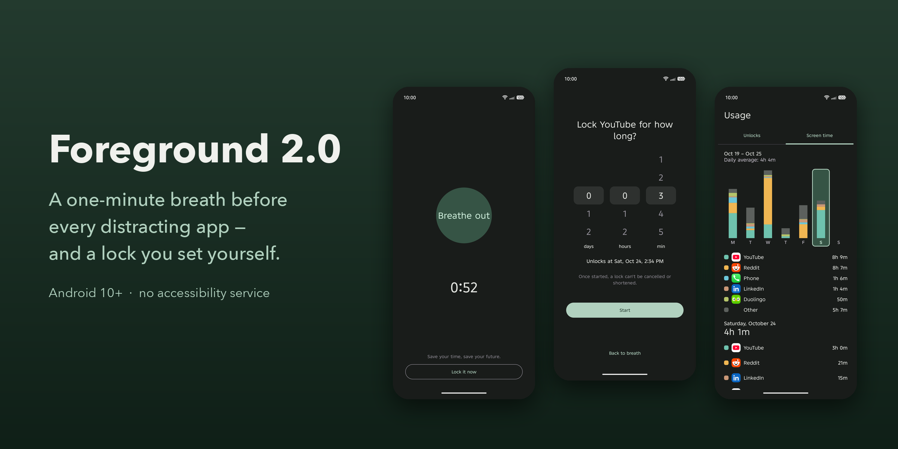
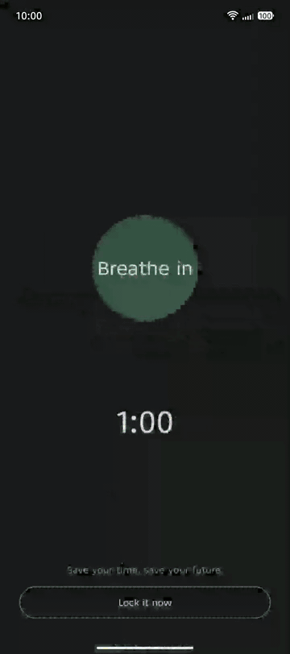
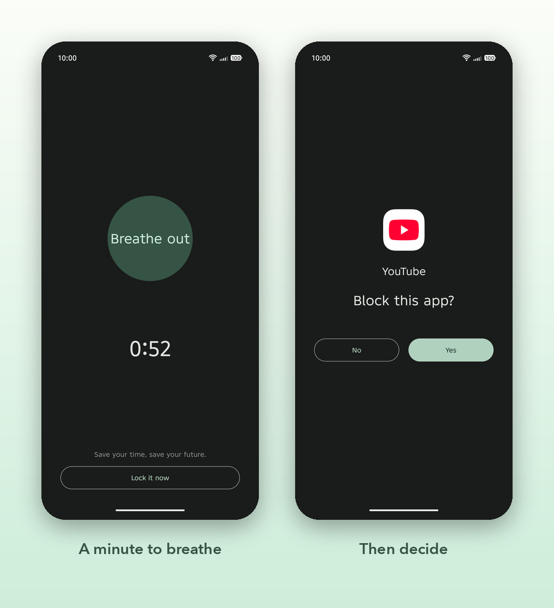
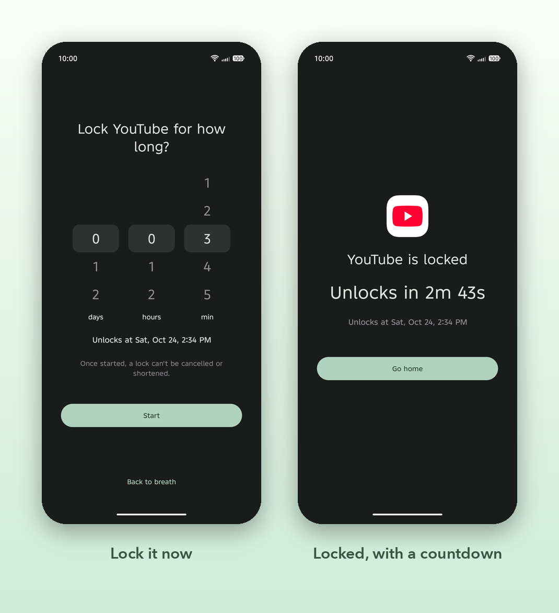
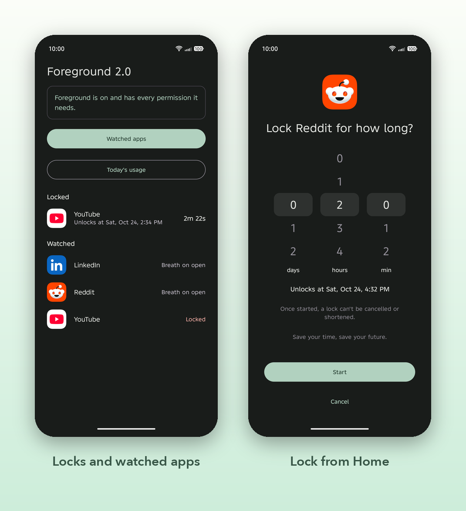
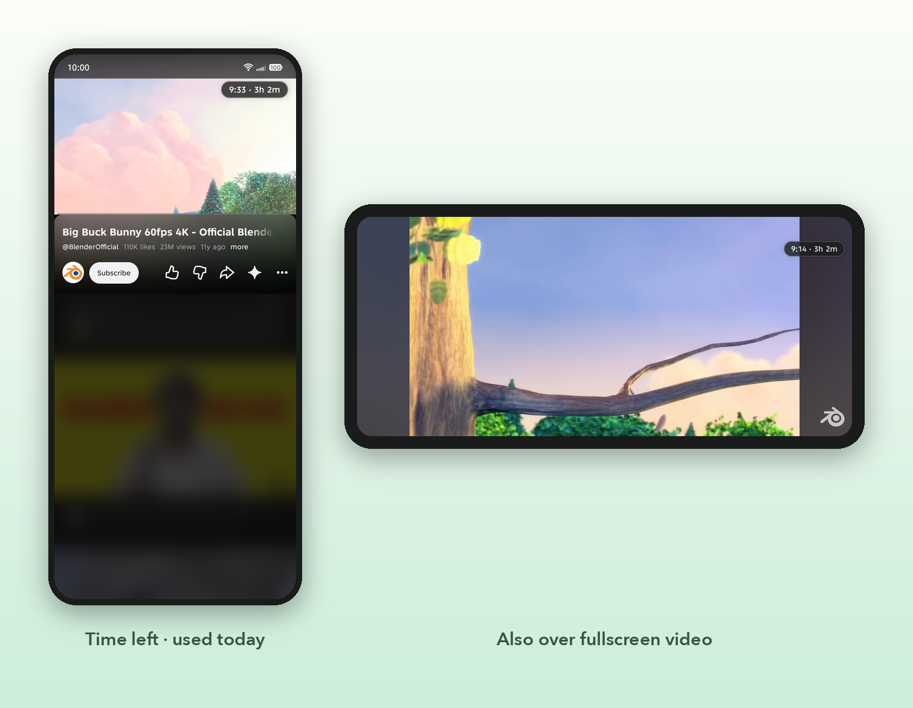
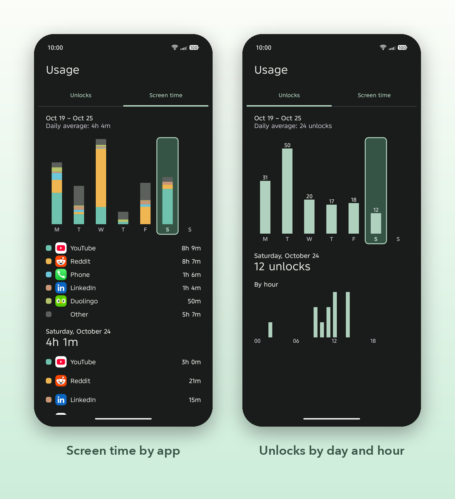
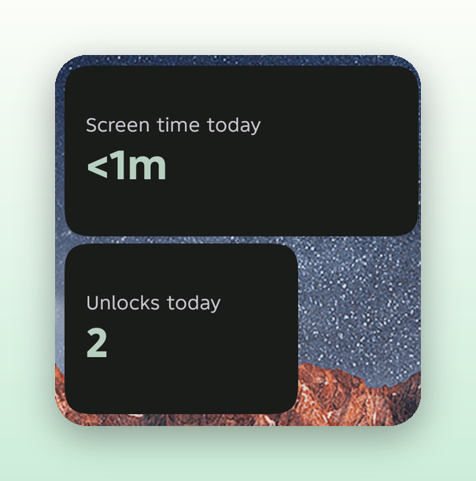
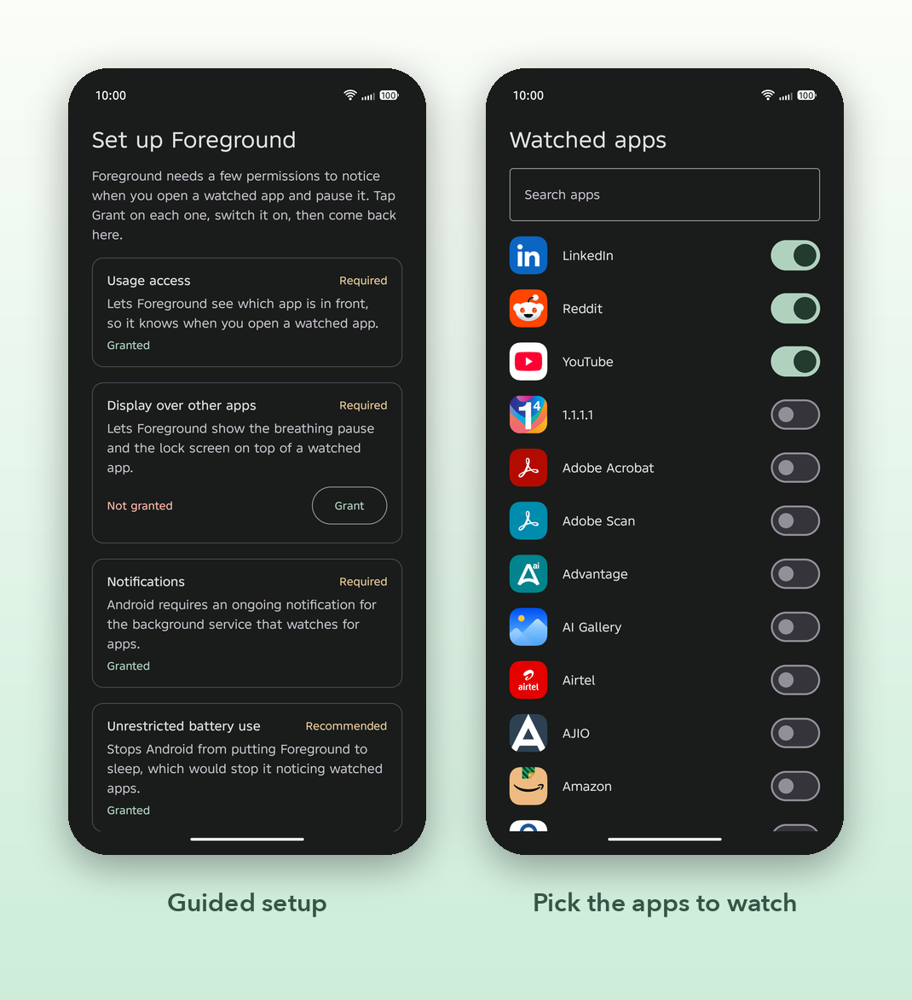

# Foreground 2.0

A one-minute breath before every distracting app — and a lock you set yourself.

-3A6E5C)




## Contents

- [The problem](#the-problem)
- [How it works](#how-it-works)
- [Features](#features)
- [Privacy](#privacy)
- [Permissions](#permissions)
- [Install](#install)
- [Limitations](#limitations)
- [Build from source](#build-from-source)
- [Tech stack](#tech-stack)
- [Project structure](#project-structure)

## The problem

- **Autopilot.** Most app opens aren't decisions. The thumb gets to YouTube before you've thought about it.
- **Blockers are easy to dismiss.** A "you've hit your limit" dialog with an "ignore" button is one tap from being ignored.
- **Accessibility-based blockers break banking apps.** Many blockers rely on an accessibility service, and Indian
  banking apps such as Axis and Canara refuse to run while an untrusted one is enabled.

Foreground puts a pause between the impulse and the app, and lets you lock an app for as long as you choose. It does
this without an accessibility service: it detects apps with Usage access and blocks them with an overlay.

## How it works



1. **Open a watched app.** A full-screen breathing pause covers it for **60 seconds**. You can't skip it, and Back
   does nothing. If you leave and come back, the minute starts over.
2. **Choose.** After the breath, Foreground asks: *Block this app?*
   - **No:** use the app for up to **10 minutes**. When the time is up, the breath comes back.
   - **Yes:** choose how long to lock it, from 1 minute to 30 days. **A lock can't be cancelled or shortened.**
3. **Locked.** While an app is locked, opening it shows a live countdown and a single **Go home** button.

You don't have to wait for the prompt: **Lock it now** on the breath screen goes straight to the lock picker.

<br clear="right">

## Features

### Breath gate

Every time you open a watched app, a minute of slow breathing comes first, then the choice. Switching back from
another app counts as opening it again.



### Lock it now and timed locks

Lock an app during the breath, without waiting for the prompt. Choose days, hours and minutes; the screen shows when
the app will unlock. Each app has its own lock, and locks survive reboots.



### Lock from Home

Tap a watched app on the Home screen to lock it in advance. A lock set from Home takes effect immediately, even while
the app is in its 10-minute window. Home lists active locks with their time left.



### Media pause

While the breath, prompt or lock screen is showing, playing media is paused and the media volume is muted. Foreground
never resumes playback afterwards; going back is your choice.

### Usage pill

During the 10-minute window, a small pill at the top right shows the time left and how long you've used the app
today, e.g. `9:33 · 3h 2m`. It stays in the same place in portrait, landscape and fullscreen video, and taps go
through it to the app.



### Weekly history

Unlocks and screen time, one week per page. Swipe back through earlier weeks. Screen time is a stacked column per day
showing the week's top five apps; tap a day to see that day's app list. Unlocks shows a count per day and a by-hour
chart. History is saved on the device, so it is kept after Android deletes its own usage log.



### Widgets

Two home-screen widgets show today's **unlocks** and **screen time**. Make the screen-time widget bigger to also see
your top three apps. Tapping a widget opens the matching stats tab.



### Setup

First launch walks you through each permission, with a button that opens the right settings page.



## Privacy

- **No internet permission.** The release APK does not request `android.permission.INTERNET`, so the app cannot open
  network connections. (`ACCESS_NETWORK_STATE` is in the manifest only because the WorkManager library adds it. It
  lets the app check whether a network exists, not use one.)
- **Your data stays on the phone.** Watched apps, locks and usage history are stored in local databases.
  `allowBackup` is off, so Android cloud backup doesn't copy them.
- **No accounts, ads, analytics or crash reporting.**
- **No accessibility service, ever.** Not now and not as an option. It's the reason banking apps keep working.

## Permissions

| Permission | Why it's needed |
|---|---|
| Usage access (`PACKAGE_USAGE_STATS`) | See which app is in front, and compute unlocks and screen time |
| Display over other apps (`SYSTEM_ALERT_WINDOW`) | Draw the breath, prompt, lock screen and usage pill |
| Notifications (`POST_NOTIFICATIONS`) | The ongoing notification Android requires for the background service, and an alert if a permission is revoked |
| Foreground service (`FOREGROUND_SERVICE`, `FOREGROUND_SERVICE_SPECIAL_USE`) | Keep detection running in the background |
| Start at boot (`RECEIVE_BOOT_COMPLETED`) | Restart detection after a reboot |
| Unrestricted battery (`REQUEST_IGNORE_BATTERY_OPTIMIZATIONS`) | Ask to be exempt from battery optimisation so Android doesn't stop the service |
| `WAKE_LOCK`, `ACCESS_NETWORK_STATE` | Added by WorkManager, which saves each day's history |

## Install

1. Download `foreground2-<version>.apk` from [Releases](https://github.com/Aladin-03/forground2.0/releases).
2. Open it on your phone. When Android asks, allow your browser or file manager to **install unknown apps**.
3. **Play Protect** may warn that the app is from an unknown developer. This is normal for an app installed outside
   the Play Store. Choose *More details → Install anyway*. You can also build it yourself
   ([below](#build-from-source)).
4. Open Foreground and grant each permission on the setup screen.
5. **Allow autostart and background activity.** Infinix (XOS), Xiaomi (MIUI/HyperOS), Oppo/Realme (ColorOS), Vivo
   (Funtouch/OriginOS) and similar Android versions close background apps aggressively, even with unrestricted battery
   use. In the app's settings, turn on **Autostart** (sometimes called *App launch* or *Auto-launch*) and allow it to
   run in the background. On some phones, also lock Foreground in the recent-apps screen. [dontkillmyapp.com](https://dontkillmyapp.com) has
   steps for each brand.
6. Tap **Watched apps** and choose the apps that should get a breath.

## Limitations

Foreground is a commitment device. It is not a prison:

- **Locks can be broken.** Turning off Usage access or the overlay permission, force-stopping the app, or
  uninstalling it stops all blocking. Foreground posts an alert when a permission is revoked, but it can't stop you.
- **Changing the clock changes locks.** Locks are stored as an end time, and the app doesn't detect clock changes.
- **A brief flash.** Detection checks for the front app every half second, so a watched app may appear for a moment
  before the overlay covers it.
- **Some media can't be paused.** Players with no media session (for example YouTube Shorts) are muted, not paused.
- **The 10-minute window is in memory only.** If the app restarts, the next open gets a fresh breath.
- **Tested on one phone** (Infinix, Android 15). Other phones' battery management may behave differently.

## Build from source

Requirements: JDK 17 and the Android SDK (compile SDK 35).

```sh
./gradlew assembleDebug          # debug APK: 10 s breath, 1 min window
./gradlew installDebug           # install on a connected phone
./gradlew detekt ktlintCheck     # static analysis
./gradlew testDebugUnitTest      # unit tests
./gradlew assembleRelease        # release APK: app/build/outputs/apk/release/foreground2-<version>.apk
```

Release builds are signed with your own key. Copy `keystore.properties.example` to `keystore.properties` (it's
git-ignored) and fill in the path to your keystore, the alias and the passwords. Debug builds and tests don't need it.

## Tech stack

Kotlin · Jetpack Compose (Material 3) · MVVM with a pure-Kotlin domain layer · Hilt · Room · DataStore Preferences ·
Navigation Compose (type-safe routes) · Glance widgets · WorkManager · KSP · JUnit 5, kotlinx-coroutines-test and
Turbine · detekt (with custom rules) and ktlint. minSdk 29, target SDK 35.

## Project structure

A single `app` module, package `com.aladin.foreground2`:

| Package | Contents |
|---|---|
| `core/domain` | Pure Kotlin: gate state machine, models, clock, daily usage stats |
| `core/data` | Room database, usage-log reader, history recorder, installed-app list, repositories |
| `core/designsystem`, `core/ui` | Theme, colours, spacing, and shared Compose pieces such as the duration picker |
| `feature/*` | Onboarding, watched-apps picker, Home, lock-from-Home, Stats |
| `service/detection` | Foreground service that detects the front app |
| `service/overlay` | Overlay windows: breath, prompt, picker, lock screen, usage pill |
| `widget` | Glance home-screen widgets |

[docs/SPEC.md](docs/SPEC.md) describes every behaviour rule and the technical approach. Each package also has a
one-line README.
